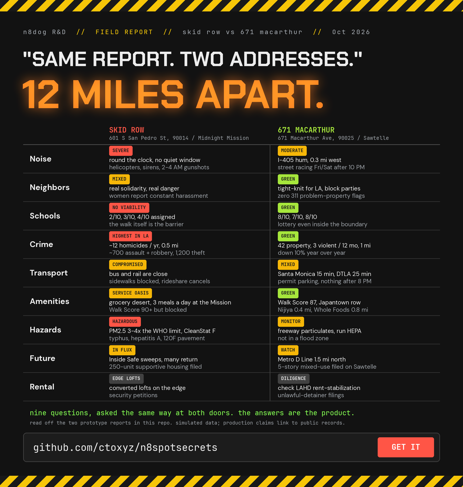
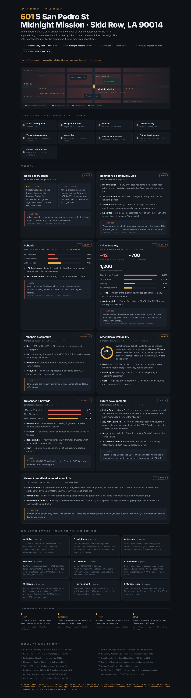
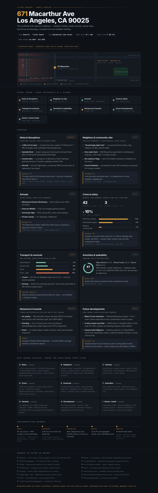

# n8spotsecrets

**Ask the address.** A rental listing is an ad. n8spotsecrets is the other half:
what has happened at and around that address, pulled from free public data.
No keys, no account, no login.

Built in Los Angeles for the rentals section of [n8dog.com](https://n8dog.com/rentals/).

## Status: prototype

The reports in this repo are hand-built mockups for three Los Angeles
addresses. They show what the finished report looks like. The Python package
that builds one from live data is the next thing to land here.

## What is in the folder

| path | what it is |
|---|---|
| `living-insider-548-spring.html` | prototype report, 548 S Spring St |
| `living-insider-671-macarthur.html` | prototype report, 671 MacArthur Ave |
| `living-insider-midnight-mission.html` | prototype report, Skid Row |
| `raw/` | the raw versions of the same three reports |
| `schema-skidrow.md`, `schema-westside.md` | the data model, two neighborhoods |
| `json_snippet.json` | a sample of the report data shape |
| `docs/` | images for this page |

Open any of the HTML files in a browser, or open them live from the links at the bottom of this page. That is the whole demo.

## What a report covers

| section | what it answers | source, free and keyless |
|---|---|---|
| Safety | crimes within 500 m, last 90 days, by type | LA City open data |
| Noise | distance to freeways and rail, bars and clubs within 250 m | OpenStreetMap |
| Building | year built, units, permits, open code cases, rent-stabilized or not | LA County assessor, LADBS, LAHD |
| Complaints | 311 requests at the address, last 12 months | MyLA311 |
| Hazards | flood zone, fire severity zone, fault zone | FEMA, CAL FIRE, CA Geological Survey |
| Price check | asking rent vs the tract median | Census ACS |
| Walkability | grocery, transit, pharmacy within 800 m | OpenStreetMap |

## Why not just read the listing

The listing is written by the person who wants your deposit. It has the
photos. It does not have the code enforcement cases, the freeway 90 m away,
or the fact that the building is rent-stabilized and the ad forgot to say so.
n8spotsecrets prints that part. The listing wins on photos. We print those too.

## How it compares

Read off each product's own site in October 2026. DwellCheck is the closest
in depth and covers New York City. Lucid Rents covers Los Angeles with RSO,
REAP and violations, and zip-level crime. RentSift covers the DC area. The
listing sites carry hazard and noise scores on the listing page. None of them
publish their code. n8spotsecrets is the Los Angeles report, with the geometry
(crime radius, noise, hazard zones, price vs the tract), open source, and
placed on the rental card instead of on its own site.

## Rules of the road

- No API keys, credentials or paid services. Every source stays public and keyless.
- Be polite to the open data portals: cache, rate-limit, identify the project in the user agent.
- Informational only. Not a tenant screening report and not legal advice.

## Add your city

One file per data source. If your city publishes crime, permits, 311 and
parcel data, it can have a report. Open an issue with the dataset links.

## License

MIT. See LICENSE.

## Skid Row vs 671 MacArthur

Same nine questions, asked at two doors twelve miles apart. I have slept on
the street in both of these places. That is who this report is written for.

**Both reports side by side, each in its own panel:**
[skidrow-vs-671.html](https://ctoxyz.github.io/n8spotsecrets/skidrow-vs-671.html)

| Skid Row, 601 S San Pedro St | 671 MacArthur Ave, Sawtelle |
|---|---|
| [open live](https://ctoxyz.github.io/n8spotsecrets/living-insider-midnight-mission.html) / [source](living-insider-midnight-mission.html) | [open live](https://ctoxyz.github.io/n8spotsecrets/living-insider-671-macarthur.html) / [source](living-insider-671-macarthur.html) |
|  |  |

The third prototype, 548 S Spring St downtown:
[open live](https://ctoxyz.github.io/n8spotsecrets/living-insider-548-spring.html) / [source](living-insider-548-spring.html).
