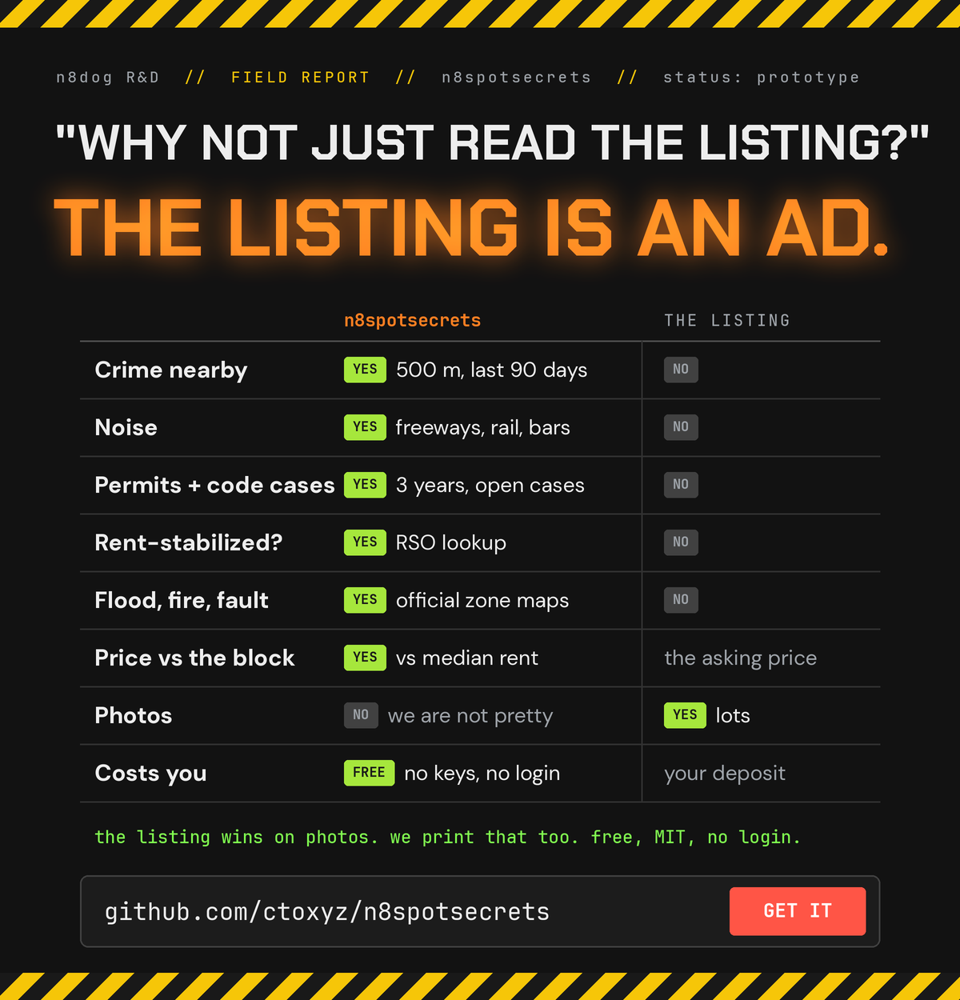
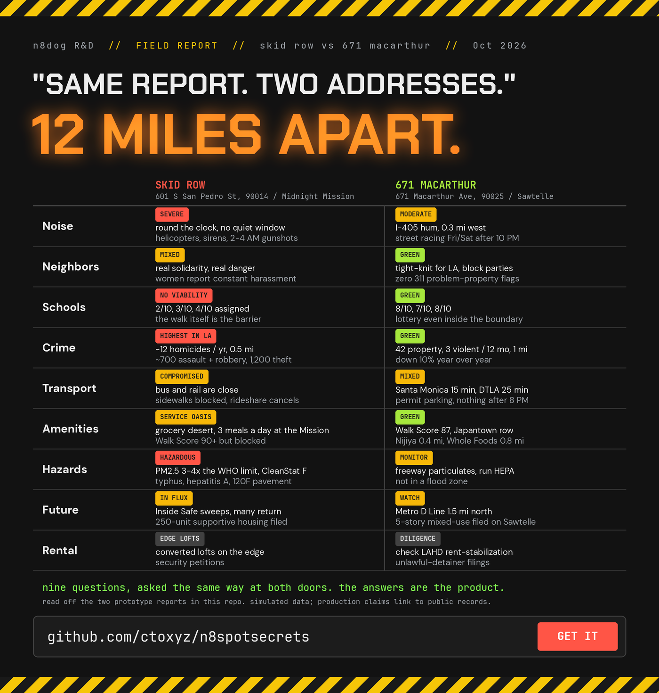
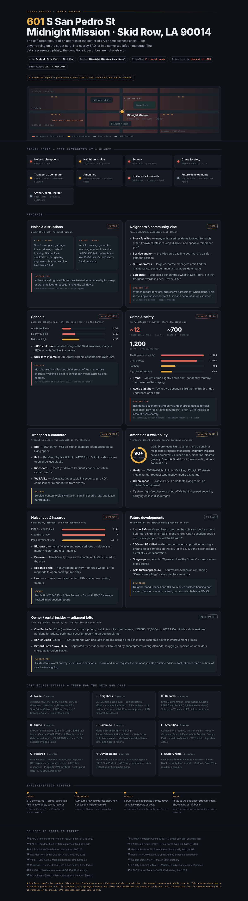
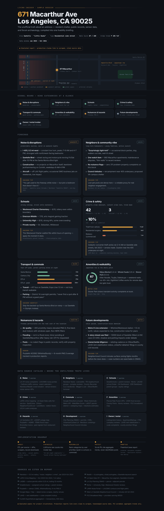

# n8spotsecrets



**Ask the address.** A rental listing is an ad. n8spotsecrets is the other half:
what has happened at and around that address, pulled from free public data.
No keys, no account, no login.

Built in Los Angeles for the rentals section of [n8dog.com](https://n8dog.com/rentals/).

## Status: live, Los Angeles only

The Python package in `n8spotsecrets/` builds a report from live public data
in a few seconds. It runs on the rentals page of
[n8dog.com](https://n8dog.com/rentals/): type an address and the report comes
back. Current version: 0.2.10. The three HTML reports further down are the
hand-built prototypes that set the target.

## Run it

```
pip install .
n8spotsecrets "548 S Spring St, Los Angeles, CA 90013"
n8spotsecrets "548 S Spring St, Los Angeles, CA 90013" --asking 2400 --beds 1 --json
```

Plain Python 3.10+, no dependencies. Or without installing:
`python -m n8spotsecrets "548 S Spring St, Los Angeles"`.

Every source answers in parallel inside a time budget (9 s by default). A
source that is slow or down leaves a blank, never a zero, and the report lists
it under `incomplete` with the reason.

Tests run offline, no network and no keys:
`python -m unittest discover -s tests -v`

## What is in the folder

| path | what it is |
|---|---|
| `living-insider-548-spring.html` | prototype report, 548 S Spring St |
| `living-insider-671-macarthur.html` | prototype report, 671 MacArthur Ave |
| `living-insider-midnight-mission.html` | prototype report, Skid Row |
| `raw/` | the raw versions of the same three reports |
| `schema-skidrow.md`, `schema-westside.md` | the data model, two neighborhoods |
| `json_snippet.json` | a sample of the report data shape |
| `docs/` | images for this page |
| `n8spotsecrets/` | the package: `geocode.py`, `report.py`, one file per source in `sources/`, `cli.py` |
| `tests/` | offline tests with recorded response shapes |
| `pyproject.toml` | `pip install .` gives you the `n8spotsecrets` command |

Open any of the HTML files in a browser, or open them live from the links at the bottom of this page.

## What a report covers

| section | what it answers | source |
|---|---|---|
| Building | year built, units, use, likely rent-stabilized (RSO) or not | LA County assessor parcels |
| Landlord file | tenant cases the housing department opened, complaints inspected, tenant buyouts, no-fault eviction filings and eviction notices, by parcel | LAHD (LA City open data) |
| Permits | building permits within 60 m, last 5 years | LADBS (LA City open data) |
| Complaints | open and closed code cases, habitability violations, by parcel | LADBS, LAHD |
| Safety | incidents and violent incidents on the block (150 m) and within 500 m, plus this year's trend for the police district | LAPD (LA City open data) |
| Hazards | flood zone, fault traces within 300 m, hillside red-flag fire area, liquefaction and landslide zones, soft-story retrofit list, airport noise contours | FEMA, CA Geological Survey, LAFD, LADBS, LA County |
| Noise | freeways and rail within 250 m, major roads within 150 m | US Census TIGERweb |
| Price check | asking rent vs the tract median, ZIP median when the tract is suppressed | US Census ACS |
| Section 8 | HUD fair market rent by bedroom, voucher households in the census tract, whether the building is on the city's list of affordable housing it funded | HUD, LAHD |
| Transit | rail and bus stops within 800 m, lines, how often they run, bikeways | Esri World Transit Stops (agency GTFS), LADOT |
| Amenities | registered businesses and parks within 800 m, and a walk index that is our own arithmetic | City of LA business registry, LA Recreation and Parks |
| Connectivity | measured internet speeds, wireline providers | Ookla open data, California PUC |
| Street | 311 requests within 250 m, air (PM2.5, diesel, traffic), the homeless count for the community | MyLA311, CalEnviroScreen 4.0, LAHSA 2020 count |
| People | renter share, age, commute, the neighborhood council | US Census ACS, City of LA |

Read the dates. LAPD's open incident data with map points ends on 2024-12-30,
when the city moved to a new reporting system, and its last year is partial.
So Safety counts calendar 2023 around the address and says so. The current
trend comes from the new system, which publishes by reporting district.
Rent stabilization is derived from the parcel record (City of LA, built
before October 1978, two or more units), plus the city's own tenant buyout
filings where there are any; confirm it on ZIMAS or with LAHD.

Coverage: Los Angeles only for now. The City of Los Angeles gets every
section. The rest of LA County gets a partial report: those cities keep their
own permit, code, police and housing data, and the report says which sections
are missing.

## Known limits

- Noise is thin: freeways, rail and airport contours. A busy boulevard can still read as quiet.
- The landlord file is looked up under one parcel number. A condo building with many parcels can undercount, and the report says so.
- A tenant case is a complaint the city opened a file on. It is not a ruling against the landlord.
- No owner names and no tenant reviews. The page links out to Google and Yelp instead.
- The business registry's categories are loose, so "grocery" includes corner stores and food makers.
- Scores are our own formula from the records above, not a rating anyone else publishes.

## Why not just read the listing

The listing is written by the person who wants your deposit. It has the
photos. It does not have the code enforcement cases, the freeway 90 m away,
or the fact that the building is rent-stabilized and the ad forgot to say so.
n8spotsecrets prints that part. The listing wins on photos. We print those too.

## How it compares


Read off each product's own site on 13 November 2026 (listing sites: October
2026). Lucid Rents is the closest in Los Angeles: owner portfolios, tenant
reviews, registered rent-stabilized units and far more buildings, with crime
graded by ZIP code. Augrented covers Los Angeles with violations and landlord
records. DwellCheck covers New York City and RentSift the DC area. None of
the four publish their code. n8spotsecrets is the Los Angeles report with the
geometry (crime on the block, hazard zones, price vs the tract), the housing
department's file on the building, Section 8 by tract, and open source. It
does not have owner names or tenant reviews.

## Rules of the road

- No credentials or paid services, ever. Every source is public. The one key
  the report can use is the free US Census key for the price check, read from
  your own environment (`CENSUS_API_KEY`); without it that section is skipped.
- Be polite to the open data portals: cache, rate-limit, identify the project in the user agent.
- Informational only. Not a tenant screening report and not legal advice.

## Add your city

One file per data source. If your city publishes crime, permits, 311 and
parcel data, it can have a report. Open an issue with the dataset links.

## License

MIT. See LICENSE.

## Skid Row vs 671 MacArthur



Same nine questions, asked at two doors twelve miles apart. I have slept on
the street in both of these places. That is who this report is written for.

**Both reports side by side, each in its own panel:**
[skidrow-vs-671.html](https://ctoxyz.github.io/n8spotsecrets/skidrow-vs-671.html)

| Skid Row, 601 S San Pedro St | 671 MacArthur Ave, Sawtelle |
|---|---|
| [open live](https://ctoxyz.github.io/n8spotsecrets/living-insider-midnight-mission.html) / [source](living-insider-midnight-mission.html) | [open live](https://ctoxyz.github.io/n8spotsecrets/living-insider-671-macarthur.html) / [source](living-insider-671-macarthur.html) |
| [](https://ctoxyz.github.io/n8spotsecrets/living-insider-midnight-mission.html) | [](https://ctoxyz.github.io/n8spotsecrets/living-insider-671-macarthur.html) |

The third prototype, 548 S Spring St downtown:
[open live](https://ctoxyz.github.io/n8spotsecrets/living-insider-548-spring.html) / [source](living-insider-548-spring.html).
