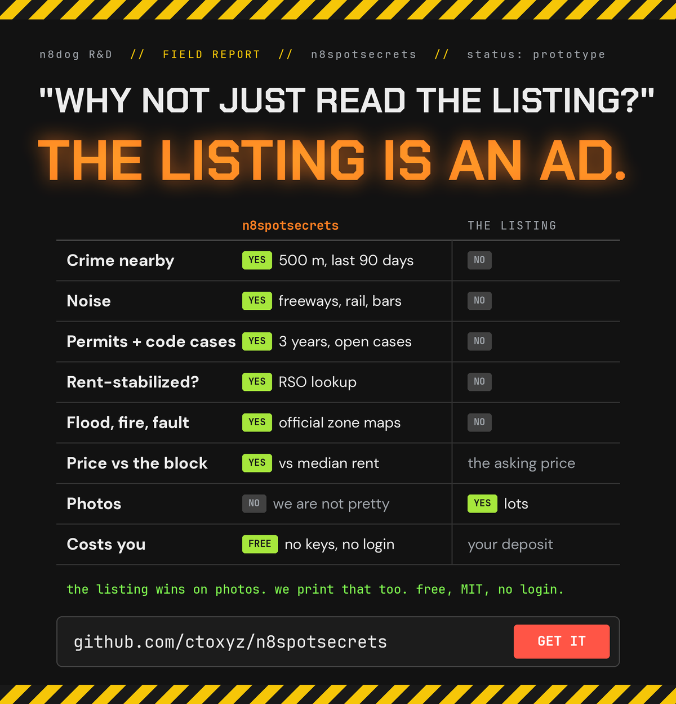
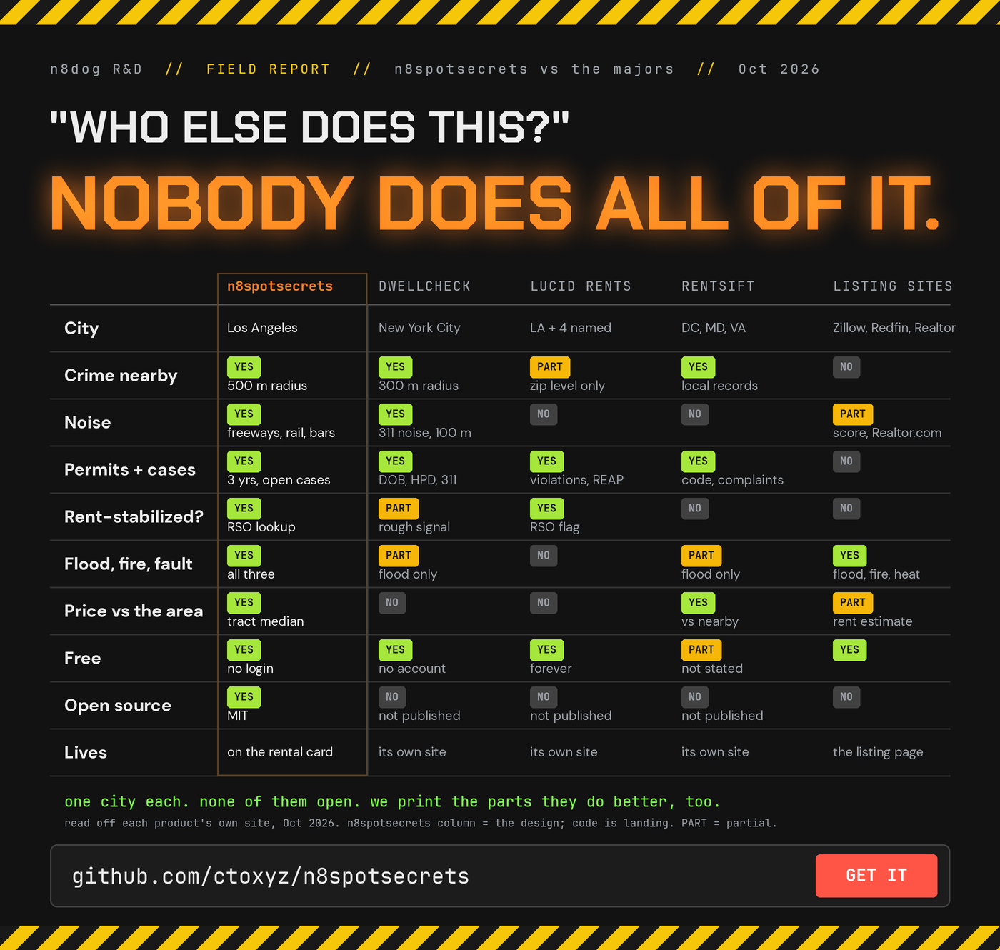
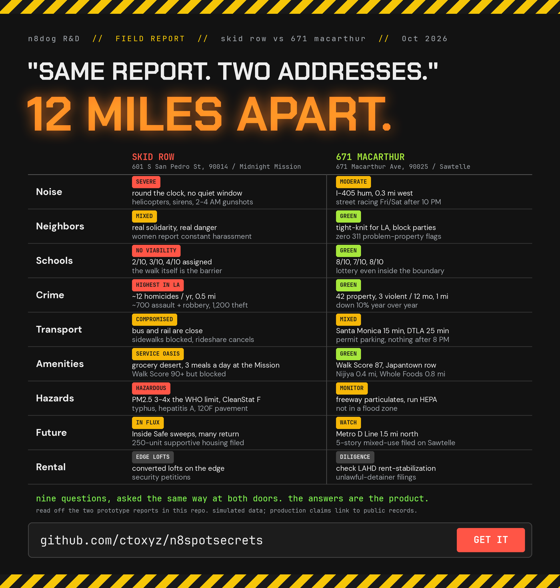
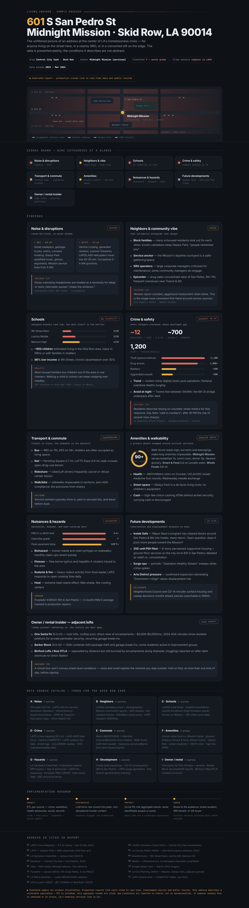
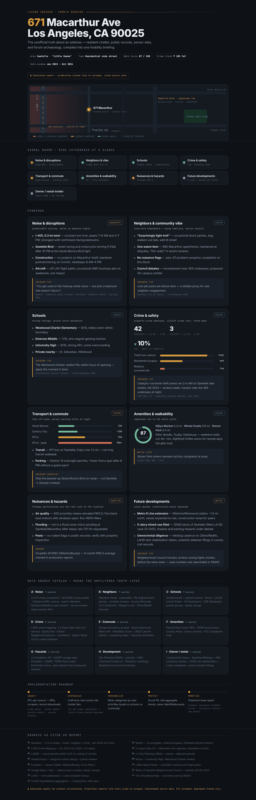

# n8spotsecrets



**Ask the address.** A rental listing is an ad. n8spotsecrets is the other half:
what has happened at and around that address, pulled from free public data.
No keys, no account, no login.

Built in Los Angeles for the rentals section of [n8dog.com](https://n8dog.com/rentals/).

## Status: live

The Python package in `n8spotsecrets/` builds a report from live public data
in a few seconds. It runs on the rentals page of
[n8dog.com](https://n8dog.com/rentals/): type an address and the report comes
back. The three HTML reports further down are the hand-built prototypes that
set the target.

## Run it

```
pip install .
n8spotsecrets "548 S Spring St, Los Angeles, CA 90013"
n8spotsecrets "548 S Spring St, Los Angeles, CA 90013" --asking 2400 --beds 1 --json
```

Plain Python 3.10+, no dependencies. Or without installing:
`python -m n8spotsecrets "548 S Spring St, Los Angeles"`.

Every source answers in parallel inside a time budget (9 s by default). A
source that is slow or down shows as "no data" and the rest of the report
still prints.

Tests run offline, no network and no keys:
`python -m unittest discover -s tests -v`

## What is in the folder

| path | what it is |
|---|---|
| `living-insider-548-spring.html` | prototype report, 548 S Spring St |
| `living-insider-671-macarthur.html` | prototype report, 671 MacArthur Ave |
| `living-insider-midnight-mission.html` | prototype report, Skid Row |
| `raw/` | the raw versions of the same three reports |
| `schema-skidrow.md`, `schema-westside.md` | the data model, two neighborhoods |
| `json_snippet.json` | a sample of the report data shape |
| `docs/` | images for this page |
| `n8spotsecrets/` | the package: `geocode.py`, `report.py`, one file per source in `sources/`, `cli.py` |
| `tests/` | offline tests with recorded response shapes |
| `pyproject.toml` | `pip install .` gives you the `n8spotsecrets` command |

Open any of the HTML files in a browser, or open them live from the links at the bottom of this page. That is the whole demo.

## What a report covers

| section | what it answers | source |
|---|---|---|
| Building | year built, units, use, likely rent-stabilized (RSO) or not | LA County assessor parcels |
| Permits | building permits within 60 m, last 5 years | LADBS (LA City open data) |
| Complaints | open and closed code cases, habitability violations, by parcel | LADBS, LAHD |
| Safety | incidents within 500 m and how many were violent | LAPD (LA City open data) |
| Hazards | flood zone, state fault traces within 300 m, hillside red-flag fire area | FEMA, CA Geological Survey, LAFD |
| Noise | freeways and rail within 250 m, major roads within 150 m | US Census TIGERweb |
| Price check | asking rent vs the tract median, ZIP median when the tract is suppressed | US Census ACS |
| Walkability | grocery, transit, pharmacy within 800 m | next release |

Read the dates. LAPD's open crime data ends on 2024-12-30, when the city
moved to a new reporting system, so Safety counts calendar 2024 and says so.
Rent stabilization is derived from the parcel record (City of LA, built
before October 1978, two or more units); confirm it on ZIMAS or with LAHD.

Coverage: the City of Los Angeles gets every section. The rest of LA County
gets building, hazards, noise and price; those cities keep their own permit,
code and police data, and the report says which sections are missing.

## Why not just read the listing

The listing is written by the person who wants your deposit. It has the
photos. It does not have the code enforcement cases, the freeway 90 m away,
or the fact that the building is rent-stabilized and the ad forgot to say so.
n8spotsecrets prints that part. The listing wins on photos. We print those too.

## How it compares



Read off each product's own site in October 2026. DwellCheck is the closest
in depth and covers New York City. Lucid Rents covers Los Angeles with RSO,
REAP and violations, and zip-level crime. RentSift covers the DC area. The
listing sites carry hazard and noise scores on the listing page. None of them
publish their code. n8spotsecrets is the Los Angeles report, with the geometry
(crime radius, noise, hazard zones, price vs the tract), open source, and
placed on the rental card instead of on its own site.

## Rules of the road

- No credentials or paid services, ever. Every source is public. The one key
  the report can use is the free US Census key for the price check, read from
  your own environment (`CENSUS_API_KEY`); without it that section is skipped.
- Be polite to the open data portals: cache, rate-limit, identify the project in the user agent.
- Informational only. Not a tenant screening report and not legal advice.

## Add your city

One file per data source. If your city publishes crime, permits, 311 and
parcel data, it can have a report. Open an issue with the dataset links.

## License

MIT. See LICENSE.

## Skid Row vs 671 MacArthur



Same nine questions, asked at two doors twelve miles apart. I have slept on
the street in both of these places. That is who this report is written for.

**Both reports side by side, each in its own panel:**
[skidrow-vs-671.html](https://ctoxyz.github.io/n8spotsecrets/skidrow-vs-671.html)

| Skid Row, 601 S San Pedro St | 671 MacArthur Ave, Sawtelle |
|---|---|
| [open live](https://ctoxyz.github.io/n8spotsecrets/living-insider-midnight-mission.html) / [source](living-insider-midnight-mission.html) | [open live](https://ctoxyz.github.io/n8spotsecrets/living-insider-671-macarthur.html) / [source](living-insider-671-macarthur.html) |
| [](https://ctoxyz.github.io/n8spotsecrets/living-insider-midnight-mission.html) | [](https://ctoxyz.github.io/n8spotsecrets/living-insider-671-macarthur.html) |

The third prototype, 548 S Spring St downtown:
[open live](https://ctoxyz.github.io/n8spotsecrets/living-insider-548-spring.html) / [source](living-insider-548-spring.html).
